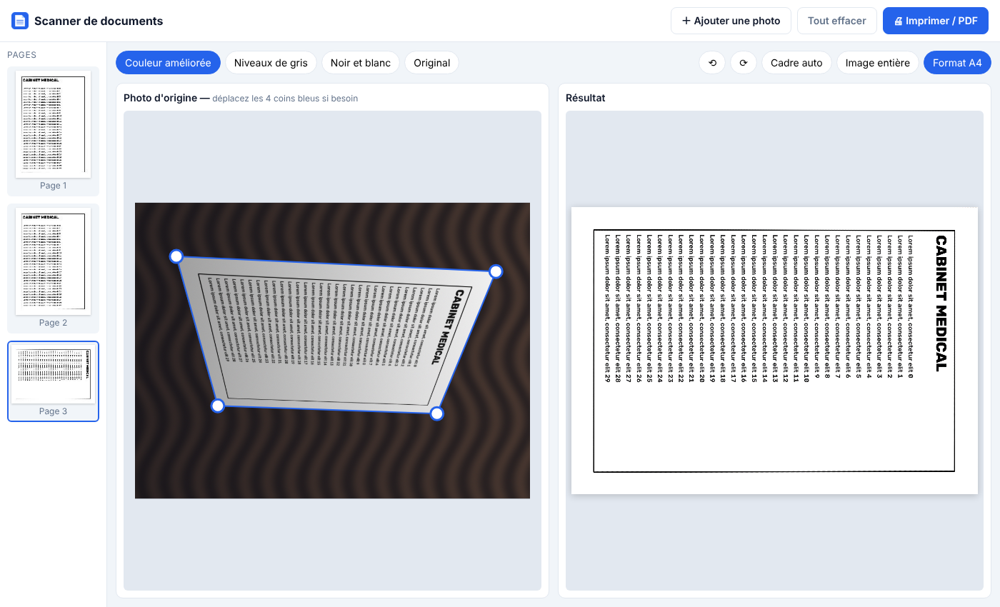

# 📄 Scanner de documents pour Gmail

Extension Chrome qui transforme les **photos de documents** reçues par mail en **documents « scannés »** : recadrés, redressés, fond blanc, prêts à imprimer en A4 ou à enregistrer en PDF.

**Tout est traité dans Chrome, sur l'ordinateur : aucune image n'est envoyée sur Internet.**

---

## ⬇️ Télécharger

👉 **[Télécharger l'extension (scanner-docs.zip)](https://github.com/TDL-Quack/Scan-Documents/releases/latest/download/scanner-docs.zip)**

## 🛠 Installer (une seule fois, environ 1 minute)

1. **Décompressez** le fichier `scanner-docs.zip` (double-clic). Rangez le dossier `scanner-docs` à un endroit où il ne sera pas supprimé, par exemple dans *Documents*.
2. Dans Chrome, tapez dans la barre d'adresse : `chrome://extensions`
3. En haut à droite, activez le **Mode développeur**.
4. Cliquez sur **Charger l'extension non empaquetée** et choisissez le dossier `scanner-docs`.
5. Cliquez sur l'icône 🧩 (en haut à droite de Chrome), puis sur l'épingle à côté de *Scanner de documents pour Gmail*.
6. Rechargez l'onglet Gmail s'il était ouvert.

> Chrome peut afficher au démarrage un message sur les extensions en mode développeur : c'est normal, il suffit de le fermer.

## ✨ Utiliser

- Dans **Gmail**, passez la souris sur une photo (pièce jointe ou image dans le mail) : un bouton bleu **📄 Numériser** apparaît. Cliquez dessus.
  *Autre possibilité : clic droit sur l'image › « Numériser ce document ».*
- Le scanner s'ouvre avec le document détecté. Si besoin, déplacez les **4 coins bleus**.
- Choisissez le rendu : **Couleur améliorée**, **Niveaux de gris**, **Noir et blanc** (économise l'encre) ou **Original**.
- Plusieurs photos ? Cliquez sur « Numériser » pour chacune : elles deviennent les pages d'un même document.
- **🖨 Imprimer / PDF** : impression en A4. Dans la fenêtre d'impression, choisissez « Enregistrer au format PDF » pour archiver.

Vous pouvez aussi glisser une photo dans la page du scanner, la coller (⌘V), ou ouvrir le scanner en cliquant sur l'icône de l'extension.

## 🔄 Mettre à jour

Téléchargez la nouvelle version avec le lien ci-dessus et remplacez le contenu du dossier `scanner-docs` par le nouveau. Ensuite, dans `chrome://extensions`, cliquez sur ↻ (Actualiser) sur l'extension.

## ❓ En cas de souci

- **Le bouton n'apparaît pas** : rechargez l'onglet Gmail.
- **« Impossible de récupérer l'image »** : téléchargez la pièce jointe, puis glissez-la dans la page du scanner.

## 🔒 Confidentialité

Voir [CONFIDENTIALITE.md](CONFIDENTIALITE.md). En résumé : l'extension ne collecte, ne stocke et ne transmet aucune donnée.

---

Pour publier une nouvelle version : modifier `version` dans `extension/manifest.json`, puis créer un tag `vX.Y.Z`. Le zip est alors généré automatiquement dans les *Releases*.
